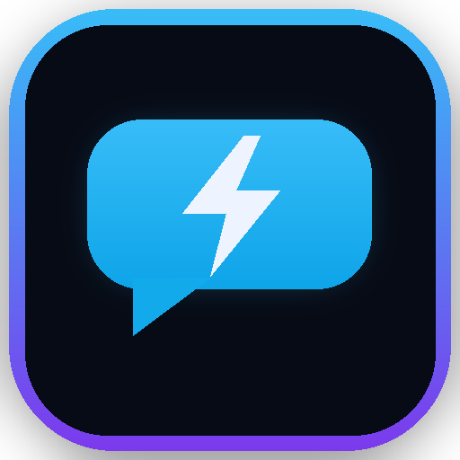
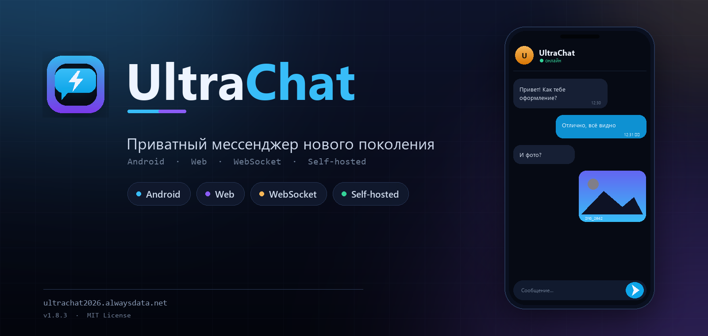
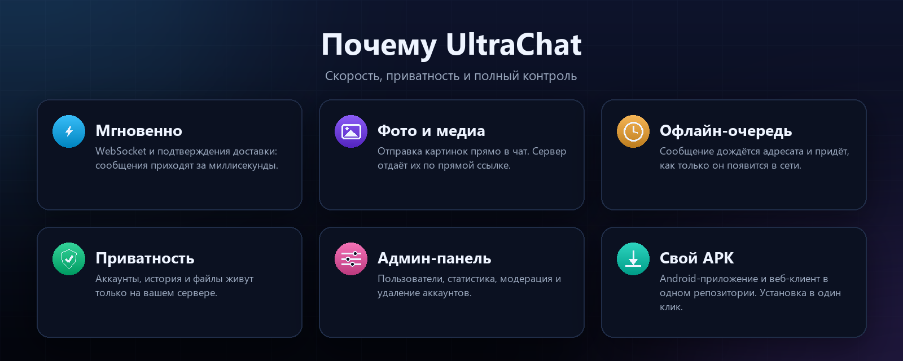
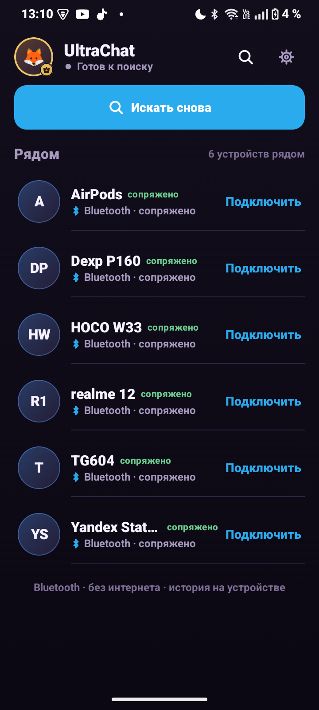
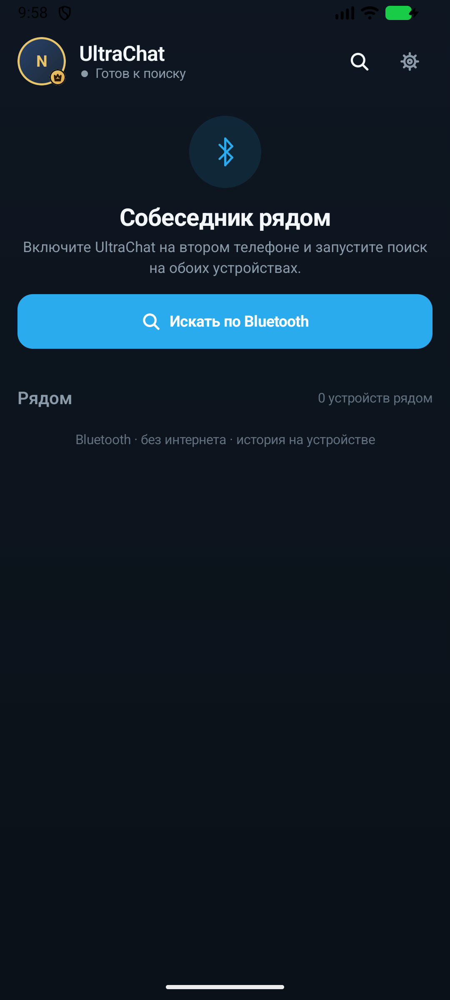
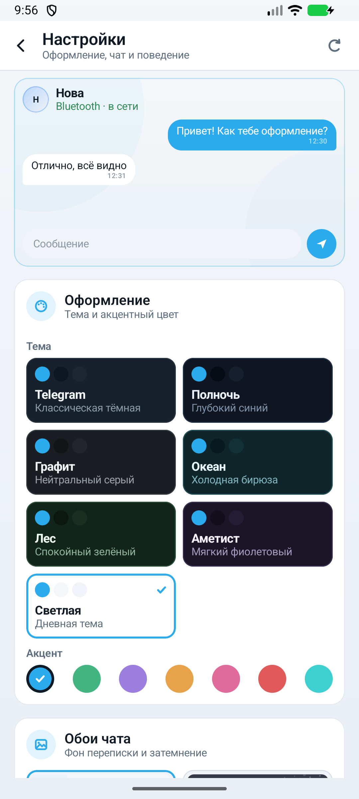
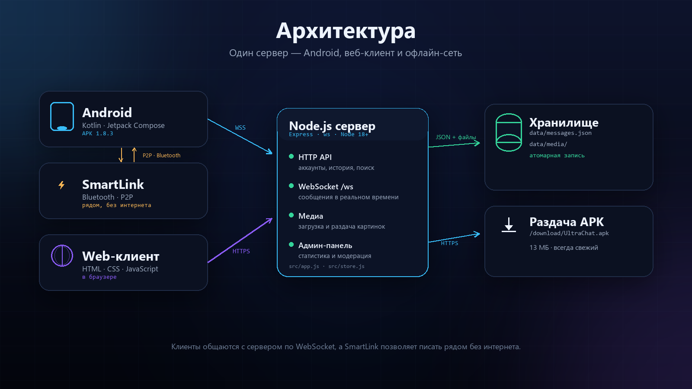

<p align="center">
  
</p>

<h1 align="center">UltraChat</h1>

<p align="center">
  <b>Приватный мессенджер нового поколения</b><br/>
  Android · Web · Node.js · WebSocket
</p>

<p align="center">
  <a href="https://ultrachat2026.alwaysdata.net"></a>
  <a href="apk/UltraChat-1.8.3.apk"></a>
  
  
</p>

<p align="center">
  
</p>

## ✨ Что такое UltraChat

**UltraChat** — это полноценный мессенджер: Android-приложение на Kotlin + Jetpack Compose, веб-клиент и лёгкий релей на Node.js. Основная версия работает на сервере **alwaysdata**, а при желании релей можно поднять на собственном сервере или в Docker — код открыт. Никакой рекламы и трекеров.

- 🌐 **Live-демо:** [ultrachat2026.alwaysdata.net](https://ultrachat2026.alwaysdata.net)
- 📱 **APK 1.8.3:** [скачать из репозитория](apk/UltraChat-1.8.3.apk) · [прямая ссылка с сервера](https://ultrachat2026.alwaysdata.net/download/UltraChat.apk)
- ⚡ **39 автотестов** сервера · **0** внешних зависимостей у клиента

## 🚀 Возможности



- **Мгновенная доставка** — WebSocket, подтверждения `ack` и восстановление истории.
- **Личные чаты** — непрочитанные, «печатает…», редактирование и удаление сообщений.
- **Фото и медиа** — загрузка картинок на сервер и раздача по прямой ссылке.
- **Офлайн-очередь** — сообщение дождётся адресата и придёт, когда он появится в сети.
- **SmartLink** — P2P-режим по Bluetooth: можно переписываться рядом без интернета.
- **Оформление** — 7 тем, акцентные цвета и обои чата.
- **Админ-панель** — статистика, бан, кик, удаление аккаунтов и рассылка.
- **Свой APK** — сервер сам раздаёт актуальную сборку приложения.

## 📦 Все версии

| Версия | APK |
|---|---|
| **1.8.3** — актуальная | [скачать](https://github.com/lofe235/UltraChat/releases/download/v1.8.3/UltraChat-1.8.3.apk) |
| 1.8.2 | [скачать](https://github.com/lofe235/UltraChat/releases/download/v1.8.2/UltraChat-1.8.2.apk) |
| 1.8.1 | [скачать](https://github.com/lofe235/UltraChat/releases/download/v1.8.1/UltraChat-1.8.1.apk) |
| 1.8.0 | [скачать](https://github.com/lofe235/UltraChat/releases/download/v1.8.0/UltraChat-1.8.0.apk) |
| 1.7.1 | [скачать](https://github.com/lofe235/UltraChat/releases/download/v1.7.1/UltraChat-1.7.1.apk) |
| 1.7.0 | [скачать](https://github.com/lofe235/UltraChat/releases/download/v1.7.0/UltraChat-1.7.0.apk) |
| 1.6.0 | [скачать](https://github.com/lofe235/UltraChat/releases/download/v1.6.0/UltraChat-1.6.0.apk) |
| 1.5.3 | [скачать](https://github.com/lofe235/UltraChat/releases/download/v1.5.3/UltraChat-1.5.3.apk) |

## 📸 Скриншоты

<table>
  <tr>
    <td align="center" width="33%">
      <br/>
      <sub><b>Поиск рядом</b><br/>Bluetooth-устройства и SmartLink</sub>
    </td>
    <td align="center" width="33%">
      <br/>
      <sub><b>Собеседник рядом</b><br/>офлайн-режим без интернета</sub>
    </td>
    <td align="center" width="33%">
      <br/>
      <sub><b>Настройки</b><br/>темы, акценты и обои</sub>
    </td>
  </tr>
</table>

## 🧭 Архитектура



| Компонент | Технологии | Что делает |
|---|---|---|
| **Android** | Kotlin, Jetpack Compose | Полноценный клиент: чаты, медиа, темы, SmartLink |
| **Web** | HTML, CSS, JavaScript | Лёгкий клиент в браузере без сборки |
| **Server** | Node.js, `ws`, `http` | Аккаунты, presence, сообщения, история, медиа |
| **Storage** | JSON + файлы | `data/messages.json`, `data/media/`, атомарная запись |
| **APK** | Gradle | Раздача `/download/UltraChat.apk` с поддержкой Range |

Один процесс Node.js обслуживает и HTTP API, и WebSocket, и статику веб-клиента, и скачивание APK.

## ⚡ Быстрый старт

Рабочий экземпляр уже доступен на [ultrachat2026.alwaysdata.net](https://ultrachat2026.alwaysdata.net) — ставить ничего не нужно. Ниже — как поднять свой сервер, если хочется независимости.

### Свой сервер

```bash
git clone https://github.com/lofe235/UltraChat.git
cd UltraChat/server
npm install
ADMIN_PASSWORD="придумайте-надёжный-пароль" npm start
```

Сервер поднимется на `http://localhost:8080` — там же открывается веб-клиент.

Чтобы сервер раздавал APK из репозитория:

```bash
APK_PATH=../apk/UltraChat-1.8.3.apk npm start
```

| Переменная | По умолчанию | Назначение |
|---|---|---|
| `PORT` | `8080` | Порт HTTP/WebSocket |
| `HOST` | `0.0.0.0` | Интерфейс прослушивания |
| `DATA_DIR` | `./data` | Аккаунты, история и медиа |
| `APK_PATH` | — | Путь к файлу APK для раздачи |
| `ADMIN_PASSWORD` | из `data/admin-password.txt` | Пароль админ-панели |

### Docker + HTTPS

```bash
cd server
cp .env.example .env
# DOMAIN=chat.example.ru
docker compose up -d
```

Caddy автоматически получит TLS-сертификат и проксирует HTTP и WebSocket.

### Android

```bash
cd android
./gradlew assembleDebug
```

Нужны JDK 17 и Android SDK. Готовый подписанный APK уже лежит в [`apk/UltraChat-1.8.3.apk`](apk/UltraChat-1.8.3.apk).

## 🔌 API

| Метод | Путь | Назначение |
|---|---|---|
| `POST` | `/api/register` | Регистрация устройства (`deviceId`, `nickname`, `avatarId`) |
| `GET` | `/api/auth/config` | Включена ли отправка писем (`delivery: smtp` / `disabled`) |
| `POST` | `/api/auth/request-code` | Отправить код входа на почту (`email`) |
| `POST` | `/api/auth/verify-code` | Проверить код и получить токен (`email`, `code`) |
| `GET` | `/api/roster?token=` | Список пользователей и онлайн-статусы |
| `GET` | `/api/search?q=&token=` | Поиск собеседников |
| `GET` | `/api/history?peer=&token=` | История переписки |
| `POST` | `/api/media?token=` | Загрузка изображения (raw body, `Content-Type: image/*`) |
| `GET` | `/media/<file>` | Раздача загруженного файла |
| `GET` | `/health` | Статус сервера и счётчики |
| `WS` | `/ws?token=` | Обмен сообщениями в реальном времени |

WebSocket-кадры: `hello`, `chat`, `ack`, `history`, `typing`, `read`, `edit`, `delete`, `delete_chat`, `ping`, `pong`.

Админ-API (Bearer-токен после `/api/admin/login`): `/api/admin/state`, `/ban`, `/unban`, `/kick`, `/delete-user`, `/notice`, `/notice/clear`, `/reset`, `/lobby/clear`.

## ✉️ Вход по коду из почты

Пароли не нужны: пользователь вводит почту, получает письмо с кодом из 6 цифр и входит.
Код живёт **10 минут**, хранится только HMAC-хешем, повторная отправка — не чаще раза
в минуту (5 писем в час на адрес, 5 попыток ввода).

Письмо — тёмная брендированная карточка с логотипом, кодом по центру, сроком действия
и информацией об устройстве. Шаблон лежит в [`email/code.html`](email/code.html),
отправка — через `nodemailer`.

Настройка отправителя (`server/data/mail.json`, в git не попадает):

```json
{
  "user": "ultrachat@gmail.com",
  "pass": "пароль-приложения",
  "from": "ultrachat@gmail.com",
  "fromName": "UltraChat"
}
```

Для Gmail нужен **App Password** (Google Account → Security → App passwords), обычный
пароль не подойдёт. Альтернатива — переменные `SMTP_HOST` / `SMTP_USER` / `SMTP_PASS`
или `GMAIL_USER` / `GMAIL_APP_PASSWORD`.

## ✅ Тесты

```bash
cd server
npm test
```

39 тестов: регистрация, presence, доставка, история, медиа, баны, лимиты, админ-панель,
вход по почте и шаблон письма.

## 📁 Структура

```
UltraChat/
├── android/            # Kotlin + Jetpack Compose приложение
│   ├── app/src/main/   # экраны, сеть, SmartLink, темы
│   └── gradle/         # Gradle wrapper
├── apk/                # готовая сборка UltraChat-1.8.3.apk
├── assets/             # баннер, логотип, схема и скриншоты
├── server/             # Node.js релей
│   ├── src/            # app.js, server.js, store.js
│   ├── public/         # веб-клиент
│   ├── test/           # 25 тестов
│   └── Dockerfile      # деплой в один контейнер + Caddy
└── README.md
```

## 🔒 Безопасность

- Папка `data/`, `.env` и Android-keystore **не попадают** в репозиторий.
- Пароль админки задаётся через `ADMIN_PASSWORD` или файл `data/admin-password.txt`.
- В продакшене используйте HTTPS/WSS (Caddy из `docker-compose.yml`).
- Токены устройств привязаны к `deviceId`; отозвать доступ можно удалением аккаунта в админке.

## 📄 Лицензия

[MIT](LICENSE) © 2026 UltraChat

---

<p align="center">
  <sub>Если проект оказался полезным — поставьте ⭐ репозиторию. Это лучшая мотивация продолжать.</sub>
</p>
